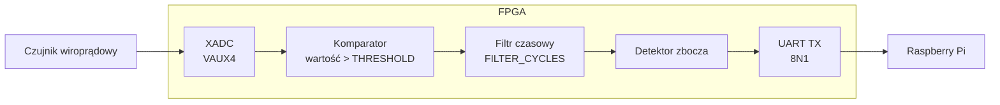
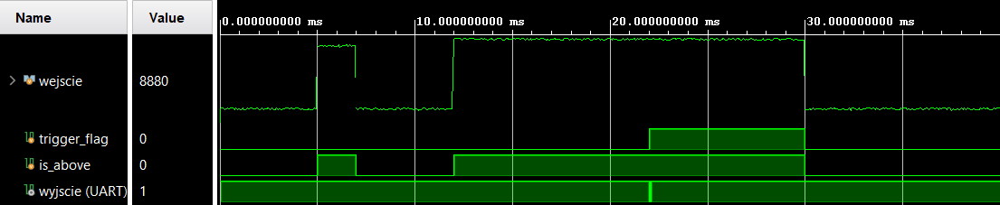
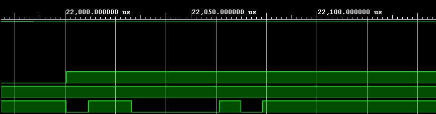

# fpga-eddy-current-uart

Sprzętowy detektor progu dla czujnika wiroprądowego. FPGA próbkuje analogowe
wyjście czujnika wbudowanym przetwornikiem XADC, filtruje je czasowo
i wysyła jeden bajt przez UART do Raspberry Pi, gdy sygnał utrzyma się
powyżej progu.


## Opis

Cały tor sygnału (przetwornik, komparator, filtr, detektor zbocza, nadajnik
UART) jest zrealizowany w logice. Czas reakcji wynika wyłącznie z zegara
i nie zależy od systemu operacyjnego ani szeregowania zadań. Raspberry Pi
dostaje gotowy bajt zdarzenia.

**Najważniejsze cechy**

- Wbudowany 12-bitowy XADC, bez zewnętrznego przetwornika
- Konfigurowalny próg i czas filtracji
- Deterministyczne opóźnienie (wszystkie bloki działają równolegle jako sprzęt)
- Jedno zdarzenie, jeden bajt: detektor zbocza zapobiega powtórzeniom
- Standardowy UART 8N1, 115200 baud, 3 przewody (TX, RX, GND)
- Logika wydzielona z modułu z XADC, dzięki czemu można ją symulować
  na danych z pliku

## Architektura



| Blok | Funkcja |
|---|---|
| XADC | Ciągła konwersja napięcia z czujnika, wynik 12-bitowy |
| Komparator | Oznacza próbki powyżej `THRESHOLD` |
| Filtr czasowy | Wymaga, aby sygnał pozostał powyżej progu przez `FILTER_CYCLES` taktów; odrzuca krótkie zakłócenia |
| Detektor zbocza | Generuje pojedynczy impuls po zadziałaniu filtra |
| UART TX | Automat stanów: bit startu, 8 bitów danych (najmłodszy pierwszy), bit stopu |

Wysyłany bajt to `0x43`

## Parametry

Zdefiniowane w `src/sensor_core.v`.

| Parametr | Domyślnie | Opis |
|---|---|---|
| `THRESHOLD` | `16'h8000` | Próg porównania na 16-bitowym wyniku XADC (połowa zakresu, ok. 1,65 V na pinie 15 płytki Cmod A7) |
| `FILTER_CYCLES` | `120_000` | Czas filtracji w taktach (10 ms przy 12 MHz) |
| `CLKS_PER_BIT` | `104` | Taktów na bit UART (12 MHz / 115200, błąd prędkości ok. 0,2 %) |

Wartości domyślne zakładają zegar systemowy **12 MHz**. Dla innego zegara
przelicz `CLKS_PER_BIT = f_zegara / baud` oraz
`FILTER_CYCLES = f_zegara * t_filtracji`.

## Sprzęt

| Element | Szczegóły |
|---|---|
| Płytka FPGA | Digilent Cmod A7-35T, zegar systemowy 12 MHz |
| Komputer | Raspberry Pi |


**Połączenia FPGA - Raspberry Pi**

| FPGA | Raspberry Pi |
|---|---|
| TX | GPIO15 / RXD (pin fizyczny 10) |
| GND | GND |

Po obu stronach napięcie logiczne wynosi 3,3 V, więc konwerter poziomów nie
jest potrzebny. Wymagana jest wspólna masa.

**Połączenia czujnika**

| Czujnik | FPGA (Cmod A7) |
|---|---|
| Wyjście analogowe | pin 15 (VAUX4) |
| Masa | GND |

**Wejście analogowe.** Sygnał z czujnika podłącz do pinu 15 płytki Cmod A7
(kanał VAUX4, para `VAUXP4` / `VAUXN4`). Zakres napięcia na tym pinie to
0-3,3 V. Jeśli wyjście czujnika wykracza poza ten zakres, przed wejściem
potrzebny jest dzielnik napięcia lub układ kondycjonowania sygnału.

## Struktura repozytorium

```
.
├── src/
│   ├── sensor_core.v        komparator, filtr, detektor zbocza, UART TX
│   └── sensor_uart.v        moduł główny: XADC + sensor_core
├── constraints/
│   └── const.xdc            przypisanie pinów
├── ip/
│   └── xadc_wiz_0.xci       konfiguracja XADC Wizard
├── sim/
│   ├── tb_sensor_core.v     testbench
│   └── adc_samples.txt      pobudzenie (jedna 16-bitowa próbka hex na linię)
├── rpi/
│   └── read_uart.py         przykładowy odbiornik
└── docs/                    schemat blokowy i wyniki symulacji
```

## Budowanie

1. Utwórz projekt Vivado dla swojego układu (xc7a35tcpg236-1).
2. Dodaj `src/sensor_core.v`, `src/sensor_uart.v` i `constraints/const.xdc`.
3. Dodaj IP XADC: zaimportuj `ip/xadc_wiz_0.xci` albo utwórz je w IP Catalog
   (XADC Wizard, włączony kanał pomocniczy VAUX4, interfejs DRP).
4. Ustaw `sensor_uart` jako moduł główny.
5. Uruchom syntezę, implementację i generowanie bitstreamu.

## Symulacja

`sensor_core` nie zależy od prymitywu XADC, więc jest symulowany na próbkach
wczytywanych z pliku tekstowego. Testbench podaje jedną próbkę co 1000 taktów
zegara i zawiera odbiornik UART, który wypisuje każdy zdekodowany bajt.

1. Dodaj `src/sensor_core.v` jako źródło projektu, a `sim/tb_sensor_core.v`
   jako źródło symulacji i ustaw testbench jako moduł główny symulacji.
2. Umieść `sim/adc_samples.txt` w katalogu uruchomienia symulacji albo ustaw
   parametr `FILE` w testbenchu na pełną ścieżkę.
3. Uruchom **Run Behavioral Simulation**, a następnie **Run All**.

**Pobudzenie (40 ms):** poziom spoczynkowy, 2 ms skoku powyżej progu, ponownie
spoczynek, następnie 18 ms utrzymującego się przekroczenia progu.

**Oczekiwany wynik:** krótki skok zostaje odrzucony przez filtr. Długie
przekroczenie zaczyna się ok. 12 ms, `trigger_flag` rośnie po 10 ms filtracji
(ok. 22 ms), a zaraz po nim pojawia się jedna ramka UART z bajtem `0x43`.



Zawartość ramki (najmłodszy bit pierwszy): `start 0 | 1 1 0 0 0 0 1 0 | stop 1`,
czyli `0x43`.


## Odbiór na Raspberry Pi

Włącz sprzętowy port szeregowy i wyłącz na nim konsolę logowania
(`raspi-config` → Interface Options → Serial Port). Następnie:

```python
import serial

port = serial.Serial("/dev/serial0", 115200, timeout=1)
while True:
    data = port.read(1)
    if data:
        print("Odebrano zdarzenie:", data)
```

Wymaga biblioteki `pyserial` (`pip install pyserial`).

## Ograniczenia

- Jeden kanał wejściowy i stały bajt w ramce
- UART tylko nadawczy (brak potwierdzenia od odbiornika)
- Parametry czasowe podano dla zegara 12 MHz i trzeba je dostosować do innych
  płytek
- Zakres wejściowy: 0-3,3 V na pinie 15 płytki Cmod A7
